# hey, i'm aaryan 👋

I'm a second-year Computer Science student specializing in **Artificial Intelligence & Machine Learning**.

Most of my time is spent building Python libraries, learning Data Science, and automating things because repeating the same task twice already feels illegal.

Currently, I'm spending an unreasonable amount of time teaching computers to understand data while simultaneously convincing myself that my code will work on the first run. (It never does.)

Sometimes I build cool stuff.
Sometimes I spend three hours debugging a missing comma.
Both count as progress.

---

## 🕷️ My Origin Story

Most people say they got into programming because they loved solving problems.

Mine is less dramatic.

I grew up watching *Ben 10*, *Spider-Man*, and every sci-fi cartoon I could find. At some point, I realized computers couldn't turn me into Alien X... so I settled for making them clean datasets instead. Not exactly the same thing, but close enough.

---

## 💻 Tech

<h3 align="center">Languages</h3>

  

<h3 align="center">Data Science &amp; ML</h3>

  

<h3 align="center">AI, Agents &amp; LLMs</h3>

  

<h3 align="center">Tools &amp; Other</h3>

  

---

## 🔄 Currently Learning
- Go
- Data Structures & Algorithms
- Machine Learning Systems
- Whatever bug I'm fighting today

---

## 📊 Dashboard

  
  

  

  

---

## 🤝 Let's Connect

If you want to talk about Python, Data Science, AI, Open Source, building weird tools, or why Ben 10 is objectively cooler than Spider-Man... feel free to reach out.

- 📧 **Email:** [aaryan28rwt@gmail.com](mailto:aaryan28rwt@gmail.com)
- 🐙 **GitHub:** [@aaryanrwt](https://github.com/aaryanrwt)
- 🐦 **X (Twitter):** [@aaryanrwt](https://x.com/aaryanrwt)

---

  Thanks for visiting. Now excuse me—I have to spend three hours debugging something that will eventually be fixed by deleting one extra space. 🔌

  

